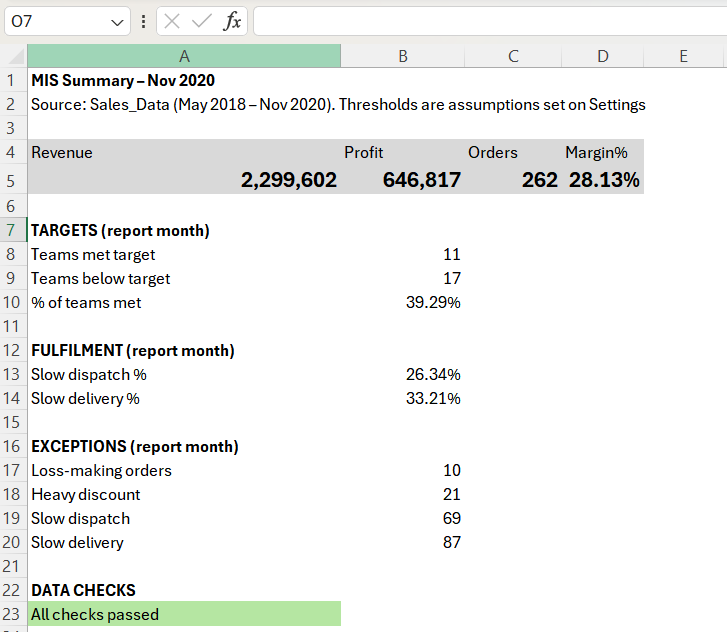
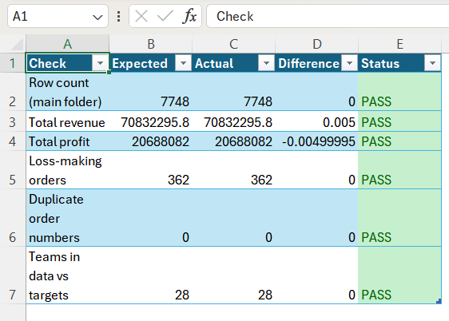
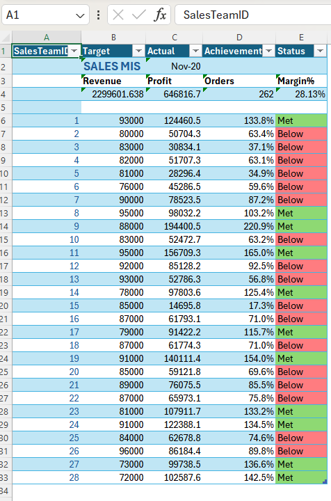

# Excel MIS Reporting Pack: US Regional Sales

A monthly MIS reporting pack built in Excel with Power Query. It combines per-warehouse sales files into one clean table, then reports sales vs target by team, fulfilment (SLA) performance and problem orders, with automatic control checks that reconcile the workbook to the source data.

**Tools:** Excel (Power Query, tables, PivotCharts, named ranges, data validation, conditional formatting, COUNTIFS / SUMIFS / INDEX-MATCH / TEXTJOIN).

## Scenario and data

A multi-warehouse distributor sends sales files every month. The analyst has to consolidate them, confirm nothing was lost, and report to management. This workbook does that in one repeatable file.

Data: Kaggle *US Regional Sales Data* (talhabu), synthetic, in USD. I split the original CSV into six warehouse files covering May 2018 to Nov 2020 (7,748 orders) to mimic branch submissions. A reconciliation key (rows, revenue and profit) was computed from the original file **before** splitting, as an independent check.

## Workbook

- **Summary:** one-page view of the report month: KPIs, teams meeting target, fulfilment rates, exception counts, check status, revenue trend.
- **Sales_MIS:** team target vs actual (Met / Below) with pivot charts.
- **Fulfilment_MIS:** per-warehouse days to ship and deliver, and SLA breach rates.
- **Exceptions:** counts of loss-making, heavy-discount, slow-dispatch and slow-delivery orders.
- **Control_Checks:** automatic PASS / FAIL tests against the key.
- **Settings:** editable thresholds and targets, with data validation.
- **Sales_Data / Pivots:** the cleaned combined table and the pivots behind the charts.

## How it works

- Power Query combines every CSV in a folder, cleans once on the combined table, and adds Revenue, Profit, margin and order-to-ship / ship-to-delivery days.
- Thresholds are named cells on Settings (SLA_Dispatch, SLA_Delivery, Max_Discount, Loss_Limit, Target_Growth), so a limit is changed in one place and every report follows.
- A Flags column tags each order with every rule it breaks, so one order can carry several flags.

## Assumptions

These settings live on the Settings sheet. Every report reads from them, so changing a value updates the whole workbook.

| Setting | Value | What it controls |
|---|---|---|
| Dispatch SLA | 21 days | Orders taking longer from order date to ship date are flagged `SlowDispatch` |
| Delivery SLA | 7 days | Orders taking longer from ship date to delivery date are flagged `SlowDelivery` |
| Heavy discount | 30% or more | Orders at or above this discount are flagged `HeavyDiscount` |
| Loss limit | profit below 0 | Orders below this profit are flagged `Loss` |
| Target growth | 5% | Team monthly target = average monthly revenue x 1.05, rounded to the nearest 1,000 |

Targets are stored as fixed values.

## Control checks

Six tests, all passing against the key: 7,748 rows, revenue 70,832,295.81, profit 20,688,082.03, 362 loss-making orders, 0 duplicate order numbers, 28 teams. A difference under 0.10 counts as rounding.

## Findings (Nov 2020)

- 262 orders, about $2.30M revenue, about $0.65M profit (28.1% margin).
- 11 of 28 teams (39%) met target.
- 26.3% of orders were dispatched late and 33.2% delivered late. Across all data, 53% of orders breach at least one rule, so the 21-day and 7-day limits are worth reviewing with the business.

## Refresh and next steps

The query reads every CSV in the data folder. To refresh, press **Data > Refresh All**, check that Control_Checks shows no FAIL, then read the Summary.

- **Tested:** refresh on the six main files, reconciled to the key (all six checks pass).
- **Not yet tested:** adding the held-back December 2020 files to the folder.
- **Setup:** the query's folder path is absolute. After downloading, repoint it via **Data > Get Data > Data Source Settings > Change Source**.

## Skills demonstrated

Multi-file consolidation with Power Query, data cleaning, reconciliation to a source of truth, parameter-driven reporting, rule-based exception reporting, KPI and SLA reporting, data validation, and a one-page management summary.
